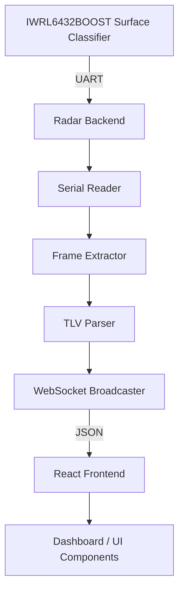

# TI IWRL6432BOOST Surface Classification Radar

This repository contains the backend and frontend components for a surface classification system using the TI IWRL6432BOOST mmWave radar. The system parses serial data from the radar, extracts Surface Classification TLV messages (identifying Wet/Dry or Grass/Not-Grass conditions), and visualizes the results in a real-time web dashboard.

## 1. PROJECT PURPOSE

The purpose of this project is to interface with a flashed TI IWRL6432BOOST radar to perform surface classification. 
The radar firmware emits raw binary frames over UART. The Python backend captures this serial stream, parses the packets, extracts the classification probabilities, and broadcasts them over WebSockets. The React frontend connects to the backend, displaying the live classification data through progress bars, charts, and responsive 2D canvas animations.

The system clearly distinguishes its layers:
- **Hardware/Firmware**: Transmits binary radar frames over UART.
- **Backend**: Parses the binary frames and normalizes the data into JSON.
- **Frontend/Visualization**: Renders the JSON into a human-readable dashboard with real-time UI components.

## 2. HARDWARE

The project targets the **TI IWRL6432BOOST** mmWave radar.
*Physical properties such as mounting height, target distance, antenna orientation, or operating environment are not specified in the current repository configuration.*

## 3. SOFTWARE STACK

| Component | Technology | Purpose |
|---|---|---|
| **Radar** | TI mmWave Firmware | Emits raw binary radar frames over UART |
| **Backend** | Python 3, `pyserial`, `websockets` | Reads serial data, extracts TLVs, serves WebSocket JSON |
| **Serial** | UART (`/dev/ttyACM*` or `COM*`) | Transport layer for radar data |
| **Parser** | Python `struct` | Robust frame and TLV binary decoding |
| **Frontend** | React 19, Vite, TailwindCSS | Real-time UI dashboard |
| **Visualization** | HTML5 Canvas API (2D) | Responsive surface simulation (Grass, Water) |

## 4. ARCHITECTURE



## 5. RADAR DATA PIPELINE

The radar data moves through the system as follows:
1. **Connection**: The backend connects to the specified serial data port (e.g., `/dev/ttyACM0`).
2. **Serial Communication**: The backend listens for the 8-byte magic word (`0x02, 0x01, 0x04, 0x03, 0x06, 0x05, 0x08, 0x07`).
3. **Frame Detection**: Upon detecting the magic word, a 32-byte header is unpacked.
4. **Packet Length**: The total frame size is extracted from the header.
5. **TLV Extraction**: The parser iterates through the frame payload, reading TLV headers (Type and Length).
6. **Classification Payload**: TLV ID `1031` (Surface Classification) is isolated, and its payload is extracted.
7. **Classification Normalization**: The raw float value is mapped to a primary and secondary confidence percentage.
8. **Backend Transmission**: The normalized dictionary is serialized to JSON and broadcast to connected WebSocket clients.
9. **Frontend Rendering**: The React application updates state, re-rendering charts, logs, and canvas animations.

## 6. TLV / CLASSIFICATION PROTOCOL

The project implements parsing for the **Surface Classification TLV** based on the flashed firmware's output.

- **TLV ID**: `1031`
- **Payload Structure**: 8 bytes total, formatted as `<If` (Little-Endian uint32, Little-Endian float).
- **Fields**:
  - `uint32_t surfaceType` (1 = Wet/Dry, 2 = Grass/Not-Grass)
  - `float classificationResult`

The backend reads these fields using Python's `struct.unpack`. The `classificationResult` is passed to the frontend as the raw confidence. *The exact mathematical meaning and calibration of `classificationResult` from the firmware is inferred as a probability where > 0.5 favors the primary class, but the exact calibrated semantics are not fully proven by the source code.*

## 7. WET / DRY CLASSIFICATION

The current representation of Wet/Dry classification utilizes the raw `classificationResult` float from the radar.
- If `classificationResult > 0.5`, the backend designates the label as "Wet".
- If `classificationResult <= 0.5`, the label is "Dry".
- The frontend maps this directly into percentages (`probabilities.WET = classificationResult`, `probabilities.DRY = 1 - classificationResult`).
- The UI uses this value to animate water ripples in the `WaterConfidenceCanvas` component.

## 8. GRASS / NOT-GRASS

Grass/Not-Grass support exists in the current project and can be selected via the UI dropdown.
- When `surfaceType == 2` is detected in the raw data (or explicitly selected in the UI), the frontend maps the classification value into probabilities for "GRASS" and "NOT GRASS".
- The visualization switches to an interactive HTML5 Canvas (`GrassCanvasMini`) displaying animated grass blades that respond to simulated wind and cursor movement.

## 9. BACKEND

The backend is written in Python and is responsible for bridging UART data to the web.
- **Entry point**: `radar_backend/web_server.py`
- **Serial handling**: Managed by the `RadarReader` thread which opens the COM port.
- **Parser**: `radar_protocol.py` (and an alternative `custom_parser.py`) extract the mmWave headers and TLVs.
- **Data normalization**: The `_shape` static method formats the parsed dict into standardized JSON for the UI.
- **API**: A WebSocket server runs on `ws://localhost:8765`.
- **Passive Mode**: The current implementation operates passively. Firmware configuration is assumed to be hard-coded on the flashed device, so no `.cfg` file or `sensorStart` command is transmitted upon connection.

## 10. FRONTEND

The frontend is a single-page React application built with Vite.
- **Framework**: React 19, TailwindCSS.
- **Dashboard Layout**:
  - **Left Sidebar**: Connection settings, baud rate, bin-flashed selector, and radar configuration summary.
  - **Center Display**: Active classification card, confidence meter, probability bar chart, and canvas animation.
  - **Right Sidebar**: Live radar features (Doppler, Range, Azimuth), frame info, and WebSocket bridge status.
  - **Footer**: Real-time event log and CSV export utility.

## 11. THREE.JS VISUALIZATION

Three.js visualization is planned/not currently present. While the `package.json` includes `@react-three/fiber` and `@react-three/drei`, the current repository implements its fluid and grass animations using the standard HTML5 2D Canvas API (`WaterConfidenceCanvas` and `GrassCanvasMini`).

## 12. DEMO MODE

The project includes a Demo Mode for UI testing without radar hardware.
- **Activation**: Toggled via the "DEMO MODE" button in the frontend.
- **Simulation**: Bypasses the WebSocket backend entirely. The frontend generates simulated classification JSON data locally.
- **Determinism**: The simulation uses deterministic sinusoidal functions tied to the frame ID to create sweeping probabilities.
- **Manual Override**: A slider is available in Wet/Dry mode to manually set the confidence level.
- **UI Indication**: The UI explicitly displays "DEMO / SIMULATING" to prevent confusion with real radar data.

## 13. REAL RADAR MODE

Real radar mode connects the physical device to the dashboard.
- **Connection**: Requires the Python `web_server.py` to be running.
- **Serial port**: Selected in the UI (e.g., `/dev/ttyACM0` or `COM5`).
- **Configuration**: The backend opens the port in a passive read-only state. No configuration commands are sent, as the firmware is assumed to auto-start.

## 14. ENVIRONMENT / SETUP

### Prerequisites
- Python 3
- Node.js (v18+) and `pnpm`
- TI IWRL6432BOOST radar connected via USB

### Backend Setup
```bash
cd radar_backend
pip install -r requirements_backend.txt
# Alternatively: pip install pyserial websockets PyQt5
```

### Frontend Setup
```bash
pnpm install
```

### Running the Project
1. **Start the backend server:**
   ```bash
   cd radar_backend
   python web_server.py
   ```
2. **Start the frontend application:**
   ```bash
   pnpm run dev
   ```
3. Open your browser to the URL provided by Vite (usually `http://localhost:5173`).

### Hardware Connection
Connect the IWRL6432BOOST via USB. Identify the Data port (e.g., `/dev/ttyACM0` on Linux, `COM5` on Windows) and enter it in the frontend connection panel.

## 15. CONFIGURATION

- **Serial Port / Baud Rate**: Configured dynamically via the frontend UI. Defaults to `115200` baud (or `921600` depending on firmware version).
- **Backend Port**: Hardcoded to `8765` for the WebSocket bridge.
- **Demo Mode**: State is persisted in browser `localStorage`.

## 16. TROUBLESHOOTING

* **Problem**: WebSocket connection fails.
  * **Observed behavior**: Red banner displays "Cannot reach ws://localhost:8765 — is radar_backend/web_server.py running?".
  * **Mitigation**: Start the Python backend before clicking Connect in the UI.
* **Problem**: Radar does not connect / no data flowing.
  * **Observed behavior**: The backend logs `Cannot open /dev/ttyACM0` or the UI stays stuck on "AWAITING RADAR DATA".
  * **Cause**: Incorrect port selected, or lack of read/write permissions on the serial port.
  * **Mitigation**: In the tested Linux environment, ensure the user is part of the `dialout` group (`sudo usermod -a -G dialout $USER`), or try the alternative Data port.

## 17. KNOWN LIMITATIONS

- **Passive Configuration**: The backend assumes the firmware auto-starts. It cannot actively configure radar hardware parameters (e.g., chirp profiles) via a CLI port.
- **Model Semantics**: The semantic meaning of the `classificationResult` float is inferred from the structure; further real-world validation is required to confirm model generalization.
- **Demo Mode**: The demo mode is completely simulated in the browser and does not validate the Python backend pipeline.
- **Padding Quirks**: Certain protocol behaviors (like a +4 byte padding workaround observed in the serial worker) are inferred from firmware output quirks.

## 18. VALIDATION

- **VERIFIED**: Radar UART connection, magic word detection, header extraction, Surface Classification (TLV 1031) parsing, WebSocket broadcasting, React UI rendering, and HTML5 Canvas animations.
- **NOT VERIFIED**: The physical accuracy and generalization of the flashed classification model in varied real-world environments.

## 19. PROJECT STATUS

| Area | Status | Notes |
|---|---|---|
| Hardware connection | Working | Requires correct OS serial permissions |
| UART reception | Working | Tested via `test_radar_incoming.py` |
| Frame parsing | Working | Magic word and header extraction functional |
| TLV parsing | Working | Surface Classification (1031) implemented |
| Classification | Partially working | Normalization logic is present; real-world accuracy unverified |
| Backend | Working | WebSocket broadcast active |
| Frontend | Working | React UI connects and parses JSON |
| Demo mode | Working | Internal sinusoidal simulation functional |
| Visualization | Working | 2D Canvas implementations (Grass, Water) working |
